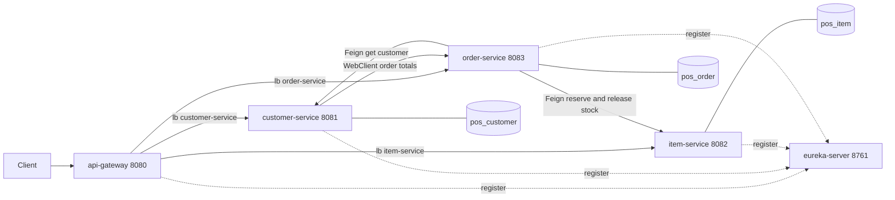

# pos-system-springboot

A demo point-of-sale (POS) system built as Spring Boot 4.1 / Spring Cloud 2025.1 microservices.
It shows the common Spring Cloud building blocks: a Eureka service registry, an API gateway,
OpenFeign clients, a reactive WebClient (WebFlux) and Resilience4j circuit breakers.

## Architecture



## Modules and ports

| Module | Port | What it does |
|---|---|---|
| `pos-common` | - | Shared library: business exceptions, the global error handler (400/404/409/503/500) and the logging, audit and performance aspects. |
| `eureka-server` | 8761 | Service registry. Dashboard at http://localhost:8761. |
| `api-gateway` | 8080 | Spring Cloud Gateway (WebFlux). Routes requests to services by name through Eureka. |
| `customer-service` | 8081 | Customers, purchase analytics, demo profile and config endpoints. |
| `item-service` | 8082 | Items and inventory. Owns stock reservation. |
| `order-service` | 8083 | Orders and order details. |

Each business service has its own database. By default this is an in-memory H2 database
(`pos_customer`, `pos_item`, `pos_order`). Set `POS_DB_URL`, `POS_DB_USER`, `POS_DB_PASSWORD`,
`POS_DB_DRIVER` and `POS_DB_DIALECT` per service to use PostgreSQL instead.

## Build and run

Requires Java 21.

```bash
./mvnw verify                  # builds every module and runs the tests
./mvnw install -DskipTests     # installs pos-common so single modules can be started
```

Start the applications in this order, each in its own terminal:

```bash
./mvnw -pl eureka-server spring-boot:run
./mvnw -pl customer-service spring-boot:run
./mvnw -pl item-service spring-boot:run
./mvnw -pl order-service spring-boot:run
./mvnw -pl api-gateway spring-boot:run
```

1. `eureka-server` first, so the others can register.
2. The three business services, in any order.
3. `api-gateway` last. Give the services a few seconds to appear in Eureka before sending requests.

Right after start-up the gateway can answer **503** for up to about a minute. The gateway only sees a
service after Eureka registration, a registry refresh (30 s by default) and a load-balancer cache refresh
(35 s by default). Requests sent before that count as failures and can open that route's circuit breaker
for 10 seconds. Wait until every service is listed at http://localhost:8761, then retry.

`scripts/e2e-smoke.sh` starts everything from the built jars and checks routing, Feign order placement,
the WebClient stats call and the circuit-breaker fallbacks. CI runs it in the `e2e-smoke` job.

Set `EUREKA_URL` if Eureka is not at `http://localhost:8761/eureka/`.

## Routes through the gateway

All public URLs keep the monolith's form, `http://localhost:8080/pos-system/...`.

| Path prefix | Service |
|---|---|
| `/pos-system/customer/**`, `/pos-system/demo/**`, `/pos-system/api/config/**` | customer-service |
| `/pos-system/item/**`, `/pos-system/inventory/**` | item-service |
| `/pos-system/order/**`, `/pos-system/order-detail/**` | order-service |

Internal endpoints used only between services are blocked at the gateway (404):

- `POST /pos-system/inventory/internal/reserve` and `/release` (item-service)
- `GET /pos-system/order/internal/customer-totals` (order-service)

Each service also serves Swagger UI at `/pos-system/swagger-ui.html` on its own port.

## Service-to-service calls

- **Placing an order** (`POST /order`): order-service checks the customer in customer-service and
  reserves stock in item-service, both through Feign. Reservation is atomic in item-service: it
  locks the inventory rows, checks every line and decrements only if all lines have stock.
  order-service then saves the order in its own transaction. If that save fails, it calls
  `release` to put the stock back.
- **Customer purchase analytics** (`/customer/purchase-stats`, `/purchase-stats-dto`,
  `/with-orders`, `/with-order-count`): customer-service fetches order totals from order-service
  with a load-balanced reactive `WebClient` and merges them with its own customers.

## Circuit breakers (Resilience4j)

| Where | Protects | Fallback |
|---|---|---|
| api-gateway | Every route | 503 with the usual error body (`timestamp`, `status`, `error`, `message`). |
| order-service | Feign calls to customer-service and item-service | Business errors (404 customer or item not found, 409 insufficient stock, 400) are passed through unchanged and do not open the circuit. Outages and timeouts become 503. |
| customer-service | WebClient call to order-service | Empty totals: the analytics endpoints still answer, with zero orders for every customer. |

## Observability

Every service (gateway, customer, item, order) uses Micrometer Tracing with Brave and sends spans
to Zipkin. One request keeps one trace id across the gateway, the Feign calls from order-service
and the WebClient call from customer-service. Each console log line shows `[traceId-spanId]`.

**Start the local stack** (Zipkin, Elasticsearch, Logstash, Kibana; development only, Elasticsearch
security is off):

```
docker compose -f observability/docker-compose.yml up -d
```

**Ship logs to ELK:** start the services with `SPRING_PROFILES_INCLUDE=elk`. Log events then go to
Logstash as JSON (with `traceId`, `spanId` and `app`) and land in one daily index per service, for
example `pos-order-service-2026.10.22`. Without the `elk` profile, logs go to the console only and
nothing connects to Logstash.

| Variable | Default | Purpose |
|---|---|---|
| `ZIPKIN_ENDPOINT` | `http://localhost:9411/api/v2/spans` | Where spans are sent |
| `TRACING_SAMPLING_PROBABILITY` | `1.0` | Share of requests traced (lower it outside development) |
| `LOGSTASH_DESTINATION` | `localhost:5000` | Logstash TCP input (used only with the `elk` profile) |

**Find a request:**
- Zipkin: http://localhost:9411, search by service or paste a trace id.
- Kibana: http://localhost:5601, create a data view for `pos-*`, then search `traceId:<id>` to see
  the log lines of every service for that request.

Actuator exposes only `health` and `info` on each service's own port (for example
`http://localhost:8083/pos-system/actuator/health`); the gateway does not route `/actuator`.
Method arguments are not written to the logs, so customer names, addresses and emails stay out of
Elasticsearch.

## Known limitations

- There is no distributed transaction. If an order save fails and the `release` call also fails,
  the reserved stock stays reduced; this is logged.
- `/order/summary-constructor` returns the customer id in `customerName`, because customer names
  live in customer-service.
- There is no authentication. Internal endpoints are blocked at the gateway but can be called on a
  service's own port.
